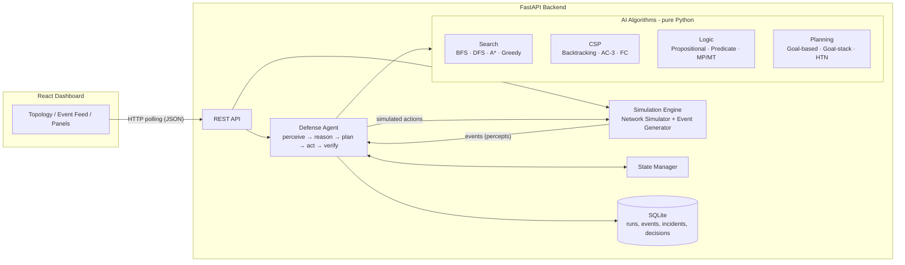
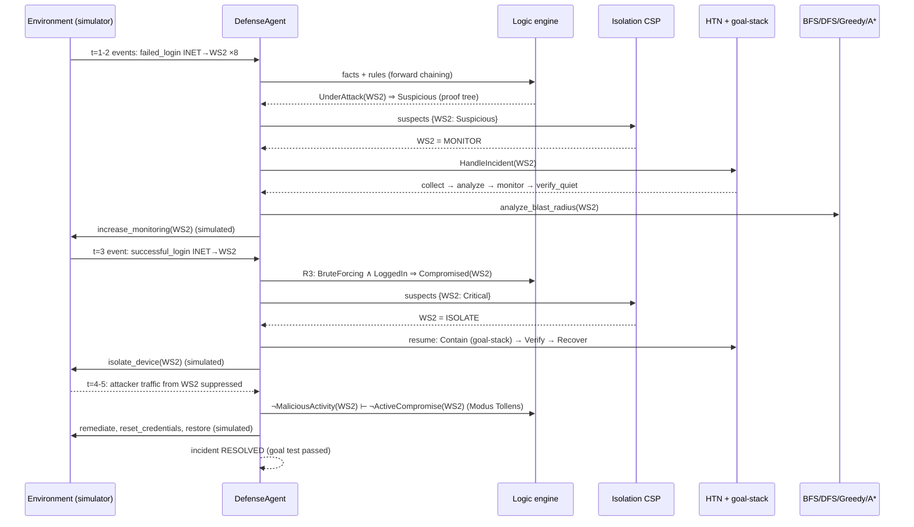

# SentinelAI — Cyber Defense AI Agent for Simulated Enterprise Networks

## Architecture & Design

> **Safety scope.** Everything in this project happens inside an in-memory simulation.
> No real packets are sent, no real hosts are scanned, and no real connections are blocked.
> All IP addresses are simulated labels (`10.x.x.x`, plus `203.0.113.1` from a reserved documentation range for the simulated internet). Every "response" is a
> state change on a Python object, and the UI and logs label it as **simulated**.

---

## 1. Agent design (PEAS)

| PEAS | Definition in this project |
|---|---|
| **Performance measure** | Score per run (see §1.2): threats contained, critical-service uptime, healthy devices left un-isolated, time-to-contain, false positives |
| **Environment** | Simulated enterprise network (devices, links, services) + scripted event stream (the "attacker" is part of the environment) |
| **Actuators** | Simulated actions: `isolate_device`, `restrict_device`, `block_link`, `reset_credentials`, `reroute_traffic`, `restore_device`, `increase_monitoring` |
| **Sensors** | Simulated security event feed: auth logs (failed/successful logins), IDS alerts (port scan), flow logs (unusual traffic), access-control logs |

### 1.1 Environment properties (AIMA classification)

| Property | Value | Why |
|---|---|---|
| Observability | **Partially observable** | The agent sees *events*, not the hidden "true compromise" flag. That's why it needs an internal model. |
| Determinism | **Stochastic** (deterministic when a seed is given) | Event generator uses `random.Random(seed)` |
| Episodic/Sequential | **Sequential** | Isolating a device now changes what's reachable later |
| Static/Dynamic | **Dynamic, discrete time** | The world advances in ticks; events arrive every tick |
| Discrete/Continuous | **Discrete** | Finite devices, actions, states |
| Agents | **Single agent** | The attacker is scripted, not adversarial search |

**Agent type:** a *model-based, goal-based* agent. It keeps an internal `NetworkState`
(model-based) and selects actions by planning toward an explicit goal state (goal-based).

### 1.2 Performance measure (rationality)

```
score =  +10 × threats_contained
         -20 × (ticks a critical service was unavailable)
          -3 × (healthy devices isolated)            # over-reaction penalty
          -1 × (ticks a compromised device stayed active)
          -5 × false_positive_incidents
```

A rational agent picks the actions that are expected to maximize this score given its percepts.
The dashboard shows this score live, so "rationality" is measurable, not just a label.

---

## 2. High-level architecture



**Layering rule:** `algorithms/` never imports from `agent/`, `api/` or `simulation/`.
Algorithms take plain data structures (graphs, variable/domain dicts, facts, actions) and
return results plus an **execution trace**. That makes them testable in isolation and
reusable for the academic demos.

```
api  →  agent  →  algorithms
  ↘      ↓  ↘
 simulation → state → models
         ↘
        storage
```

---

## 3. Component responsibilities

| # | Component | Folder / file | Responsibility | Key data structures |
|---|---|---|---|---|
| 1 | Network Simulator | `simulation/network_builder.py`, `simulation/environment.py`, `simulation/actions.py` | Load topology; hold the *true* world + hidden ground truth (`HiddenState`); execute simulated actions; suppress events that containment makes impossible | adjacency list `dict[str, list[Link]]` |
| 2 | Event Generator | `simulation/event_generator.py`, `simulation/scenarios.py` | Emit events per tick from a scenario script + seeded background noise | `random.Random(seed)`, event queue `deque` |
| 3 | State Manager | `state/state_manager.py` | The agent's internal model: current state, beliefs, event log, transition history `(s, a, s')` with diffs | dicts, sets, lists |
| 4 | Threat Detection | `agent/detection.py` | Turn events → evidence → facts; classify each device Normal / Suspicious / Critical with an explanation | sliding window counters, dict |
| 5 | Search Engine | `algorithms/search/*.py` | BFS blast radius, DFS attack paths, A* safe route, Greedy investigation path | `deque`, list-as-stack, `heapq`, sets |
| 6 | Constraint Solver | `algorithms/csp/*.py`, `agent/isolation_csp.py` | Choose ISOLATE / RESTRICT / MONITOR per suspect without breaking critical services | domains `dict[var, set]`, arc queue |
| 7 | Knowledge & Logic | `algorithms/logic/*.py` | Propositional expressions, Horn-clause forward chaining with unification, MP/MT, proof traces | facts `set[tuple]`, rules list |
| 8 | Planning Engine | `algorithms/planning/*.py` | STRIPS actions, forward goal-based planner, goal-stack planner, HTN decomposition | `frozenset` states, stack, task tree |
| 9 | Investigation, Response & Verification | `agent/investigation.py`, `agent/response_planning.py`, `agent/verification.py` | Run BFS/DFS/Greedy/A* for an incident; STRIPS domain + HTN methods; Modus Tollens check before resolution | — |
| 10 | Agent loop & evaluation | `agent/agent.py`, `agent/session.py`, `agent/performance.py` | Orchestrates perceive → reason → decide → plan → act → verify; the environment-side meter computes the score and detection metrics | — |
| 11 | Storage | `storage/database.py`, `storage/repository.py` | SQLite via stdlib `sqlite3` (no ORM) | tables in §7 |
| 12 | API | `api/routes.py`, `main.py` | REST endpoints, simulation control, persistence | Pydantic request model |
| 13 | Dashboard | `frontend/src/...` | Visualize real backend output only | React Flow graph |

---

## 4. Folder structure

```
SentinelAI/
├── README.md                      setup, run commands, document index
├── docs/                          ARCHITECTURE, ALGORITHMS, RESULTS, SYLLABUS_MAPPING, REPORT_OUTLINE,
│                                  PRESENTATION, VIVA_QUESTIONS, CHECKLIST, PROJECT_BRIEF, sample_runs/
├── backend/
│   ├── requirements.txt · pytest.ini
│   ├── app/
│   │   ├── main.py                FastAPI app factory
│   │   ├── core/                  config.py, logging_setup.py, console.py
│   │   ├── models/                enums.py, network.py, events.py, incident.py
│   │   ├── state/                 state_manager.py              (internal model, s' = T(s, a))
│   │   ├── simulation/            network_builder.py, environment.py (hidden ground truth),
│   │   │                          actions.py, scenarios.py, event_generator.py
│   │   ├── algorithms/
│   │   │   ├── search/            graph.py, bfs.py, dfs.py, astar.py, greedy_best_first.py,
│   │   │   │                      heuristics.py, costs.py
│   │   │   ├── csp/               csp.py, propagation.py, backtracking.py, examples.py
│   │   │   ├── logic/             propositional.py, predicate.py, knowledge_base.py, inference.py
│   │   │   └── planning/          strips.py, goal_based.py, goal_stack.py, hierarchical.py
│   │   ├── agent/                 agent.py (loop), detection.py, investigation.py, isolation_csp.py,
│   │   │                          response_planning.py, verification.py, performance.py,
│   │   │                          session.py, run.py (CLI)
│   │   ├── storage/               database.py, repository.py
│   │   ├── api/                   routes.py
│   │   └── demos/                 search_demo, astar_demo, csp_demo, logic_demo, planning_demo
│   ├── data/
│   │   ├── topologies/            enterprise_default.json (incl. dashboard layout)
│   │   ├── scenarios/             s1_normal.json … s8_multi_step.json
│   │   └── rules/                 security_rules.json
│   └── tests/                     23 test files, 315 tests
└── frontend/                      Vite + React + React Flow
    └── src/                       App.jsx, api.js, styles.css,
                                   components/ (Topology, EventFeed, IncidentsPanel,
                                   AlgorithmPanels, ReportPanel, common)
```

## 5. Network state model

All models are Python `dataclasses` (no ORM). Enums keep values explicit.

### 5.1 Entities

```python
class DeviceType(Enum):   WORKSTATION, ADMIN_WORKSTATION, SERVER, DATABASE,
                          ROUTER, FIREWALL, EXTERNAL
class DeviceStatus(Enum): ONLINE, RESTRICTED, ISOLATED, OFFLINE   # what the network does
class ThreatLevel(Enum):  NORMAL, SUSPICIOUS, CRITICAL             # what the agent believes
# "Is it really compromised?" is hidden ground truth kept by the simulator (M3),
# never stored in the agent's model. That is what makes the environment partially observable.
class LinkStatus(Enum):   ACTIVE, BLOCKED

@dataclass
class Device:
    id: str                    # "WS1"
    name: str                  # "Workstation 1"
    type: DeviceType
    zone: str                  # "office" | "dmz" | "server" | "core" | "external"
    ip: str                    # simulated label, e.g. "10.0.1.11"
    services: list[str]        # services hosted here, e.g. ["auth"]
    criticality: int           # 1 (low) … 5 (crown jewel)
    trust_level: float         # 0.0 … 1.0 (static trust of the device class/zone)
    risk_score: float = 0.0    # 0.0 … 1.0 (dynamic; updated from evidence)
    status: DeviceStatus = ONLINE
    threat_level: ThreatLevel = NORMAL

@dataclass
class Link:
    source: str; target: str   # undirected; stored in both adjacency lists
    latency_cost: float        # base traversal cost (> 0)
    risk: float                # 0.0 … 1.0 inherent link risk (e.g. crosses DMZ)
    status: LinkStatus = ACTIVE

@dataclass
class Service:
    name: str                  # "auth"
    hosts: list[str]           # devices providing it, e.g. ["AUTH1"]
    critical: bool
    depends_on: list[str]      # other services, e.g. app → ["db", "auth"]

@dataclass
class SecurityEvent:
    id: str; tick: int
    type: EventType            # FAILED_LOGIN, SUCCESSFUL_LOGIN, PORT_SCAN,
                               # UNUSUAL_TRAFFIC, UNAUTHORIZED_ACCESS, NORMAL_TRAFFIC
    source: str; target: str | None
    details: dict

@dataclass
class Incident:
    id: str; opened_tick: int; devices: list[str]
    level: ThreatLevel; status: IncidentStatus   # OPEN, CONTAINED, RESOLVED, ESCALATED
    explanation: list[str]     # proof trace from the logic engine
    plan: list[str]; actions_taken: list[ActionRecord]; verified: bool
```

### 5.2 `NetworkState` — the agent's internal model

```python
@dataclass
class NetworkState:
    tick: int
    devices: dict[str, Device]
    adjacency: dict[str, list[Link]]     # adjacency list (graph for search)
    services: dict[str, Service]
    evidence: dict[str, Evidence]        # per-device counters in a sliding window
    facts: set[tuple]                    # e.g. ("Connected","WS1","R1"), ("Compromised","WS2")
    incidents: dict[str, Incident]

class StateManager:                      # owns the NetworkState
    event_log: list[SecurityEvent]       # every percept received
    transitions: list[Transition]        # (tick, action, params, digest_before, digest_after, changes)
```

**State transition:** `s' = T(s, a)`. `StateManager.apply(action, params, effect)` deep-copies
`s`, runs the action's effect on the copy, and only then replaces the state. If the effect
raises (for example a failed precondition), `s` is untouched, so actions are atomic. Each
`Transition` stores a human-readable diff (`"WS2.status: online -> isolated"`) for the dashboard.

**Planning state** (M8) is a *projection* of `NetworkState` onto ground literals —
a `frozenset` like `{Compromised(WS2), Online(WS2), Connected(WS2,R1), Hosts(AUTH1,auth)}` —
so the planners stay small, hashable and testable.

### 5.3 Default topology (`enterprise_default.json`, 16 devices, 16 links)

```
                    INET (external, simulated)
                      │ cost 5, risk 0.9
                     FW1 (firewall) ──── WEB1, WEB2   (DMZ, web service)
                      │
                     R1 (core router) ──── WS1 WS2 WS3 WS4 ADMIN1   (office)
                    /  \
        direct     /    \  backup route
        cost 2    /      R3 (backup router)
                 /      /   cost 2 + 2
                R2 (server router)
                 │
       APP1  DB1  DB2  AUTH1   (server zone)
```

| Service | Hosts | Critical | Depends on |
|---|---|---|---|
| web | WEB1, WEB2 | yes | app |
| app | APP1 | yes | db, auth |
| db | DB1, DB2 (replica) | yes | — |
| auth | AUTH1 (single host!) | yes | — |

Design choices that make the scenarios meaningful:
- **R1–R2 direct + R1–R3–R2** gives A* an alternative route when the direct link is blocked (scenario 6).
- **AUTH1 is the only auth host**, so the CSP must refuse to isolate it (scenario 7).
- **DB1/DB2 and WEB1/WEB2 replicas** let the CSP isolate one but not both.

---

## 6. How each AI technique is used in the main workflow

### 6.1 Agent loop (one tick)

```
percepts   = simulator.step(tick)                         # Perception
state      = state_manager.update(percepts)               # Model update (internal state)
kb.tell(facts_from(state, percepts))                      # Knowledge base
derived, proofs = forward_chain(kb)                       # Reasoning (Modus Ponens)
levels     = detector.classify(state, derived, proofs)    # Normal / Suspicious / Critical
for each new or escalated incident:
    blast      = bfs(graph, source, max_depth)            # who is affected?
    paths      = dfs_all_paths(graph, source, assets)     # how could it spread?
    focus      = greedy_best_first(graph, source, asset)  # fast investigation lead
    isolation  = solve_isolation_csp(state, suspects)     # what can we safely cut?
    plan       = plan_incident(planning_state, device)    # HTN: Detect→Investigate→Contain→Verify→Recover
                 (Contain step expanded by goal-stack planner)
    for action in plan: response.execute(action)          # validate preconditions → apply effects
    route      = astar(graph, ADMIN1, target, h)          # safe management route after changes
    verified   = verification.check(state, goal, kb)      # goal test + Modus Tollens
score = performance.update(state)                         # Rationality measure
```

### 6.2 Search

| Algorithm | Question it answers | Graph details |
|---|---|---|
| **BFS** | "Which devices can the suspect reach within *k* hops?" (blast radius, by level) | Only ACTIVE links, skip ISOLATED nodes |
| **DFS** | "What are all simple attack paths from the suspect to critical assets?" | Depth-limited, recursive with visited-on-path set |
| **A\*** | "What's the cheapest, lowest-risk route from ADMIN1 to a server, avoiding blocked links and compromised nodes?" | `g` = Σ (latency_cost + λ·risk(edge) + μ·risk_score(next node)) |
| **Greedy Best-First** | "Which direction should investigation follow first toward the crown jewel?" | Uses only `h(n)`, fast but not optimal; compared with A* in the demo |

**A\* heuristic.** The graph has no coordinates, so we can't use straight-line distance. Instead:

```
h(n) = hops(n, goal) × c_min
    hops(n, goal) = BFS hop distance from n to goal (reverse BFS, computed once per query)
    c_min         = minimum possible edge cost in the graph
```

- **g(n)** is the *actual* accumulated cost of the path found so far.
- **h(n)** is an *estimate* of the remaining cost. Every remaining hop costs at least `c_min`,
  so `h` never overestimates (**admissible**). Because `h(n) ≤ c(n,n') + h(n')` it is also
  **consistent**, so A* returns an optimal path without re-opening nodes.
- **f(n) = g(n) + h(n)** orders the priority queue (`heapq`).

### 6.3 CSP: safe isolation (implemented in M6, see `agent/isolation_csp.py`)

- **Variables:** one `X_d` per internal, still-connected device rated Suspicious or Critical.
- **Domain (preference-ordered):** Critical `[ISOLATE, RESTRICT, MONITOR]`, Suspicious
  `[MONITOR, RESTRICT, ISOLATE]`. RESTRICT keeps only service traffic and blocks malicious outbound traffic.
- **Constraints:**
  1. `restrict_needs_service` *(unary)*: a device hosting no service cannot be RESTRICTED
  2. `contain_compromised` *(unary)*: Critical ⇒ not MONITOR
  3. `keep_sole_critical_host` *(unary)*: last available host of a critical service ⇒ not ISOLATE
  4. `keep_one_replica` *(binary; n-ary for >2 hosts)*: remaining replicas not all ISOLATED
  5. `admin_can_reach_services` *(global)*: ADMIN1 keeps a path to every critical host it reaches now
  6. `isolation_budget` *(global)*: at most K devices ISOLATED (default 2)
- **Solving:** backtracking + MRV/degree, node consistency, AC-3, forward checking.
  LCV is off for this CSP because the domain order *is* the security preference.
- **No solution** → the agent escalates instead of acting (e.g. compromised ADMIN1, compromised R2,
  R3 compromised while R1–R2 is down, budget exceeded).

### 6.4 Knowledge & logic

- **Propositional** (`propositional.py`): an expression tree with `Symbol`, `Not`, `And`, `Or`,
  `Implies`, `Iff`, truth-table evaluation, and model-checking entailment `KB ⊨ α` for small
  KBs (educational demo plus unit tests).
- **Predicate** (`predicate.py`, `inference.py`): ground facts like `Connected(WS1,R1)` and
  Horn rules with variables, for example
  `Compromised(?d) ∧ Connected(?d,?s) ∧ HostsCritical(?s) ⇒ CriticalThreat(?d)`.
  **Forward chaining** with unification derives new facts until fixpoint. Each derived fact
  keeps a **proof record** (rule + premises), which becomes the explanation on the dashboard.
- **Modus Ponens:** every forward-chaining step (`P`, `P ⇒ Q` ⊢ `Q`).
- **Modus Tollens** (used in verification): the simulation guarantees
  `ActiveCompromise(d) ⇒ MaliciousTrafficObserved(d)`. After containment, if no malicious
  traffic is observed for N ticks, `¬MaliciousTrafficObserved(d)` ⊢ `¬ActiveCompromise(d)`.
- **Honesty note:** this is Datalog-style forward chaining over Horn clauses, *not* a full
  first-order theorem prover (no resolution refutation, no existential quantifiers). It is
  documented that way.

### 6.5 Planning

- **STRIPS actions** (`strips.py`): `name`, `preconditions`, `add_list`, `delete_list`, for example

  ```
  IsolateDevice(d)
    pre:  Compromised(d), Online(d), IsolationApproved(d)
    add:  Isolated(d), Contained(d)
    del:  Online(d)
  ```

- **Goal-based planning** (`goal_based.py`): forward BFS through planning states to the goal
  set, giving the shortest plan for small problems.
- **Goal-stack planning** (`goal_stack.py`): the classic STRIPS goal-stack algorithm, used to
  expand the *Contain* phase (for example goal `Contained(WS2)` → push preconditions →
  `IsolationApproved(WS2)` → `ApproveIsolation(WS2)` …).
- **Hierarchical planning** (`hierarchical.py`): HTN decomposition.
  `HandleIncident → Detect → Investigate → Contain → Verify → Recover`. Each compound task has
  methods with applicability conditions. For example, *Contain* uses `IsolateMethod` if the
  CSP said ISOLATE, `RestrictMethod` if RESTRICT, otherwise `EscalateMethod`.
- **Verification:** an incident becomes RESOLVED only if `goal ⊆ current_facts` **and** the
  Modus Tollens check passes.

---

## 7. Storage (SQLite, stdlib `sqlite3`)

| Table | Columns (main) |
|---|---|
| `runs` | id, scenario_id, seed, started_at, final_score |
| `events` | id, run_id, tick, type, source, target, details_json |
| `incidents` | id, run_id, opened_tick, closed_tick, level, status, devices_json, explanation_json |
| `actions` | id, run_id, incident_id, tick, action, params_json, result, simulated (always 1) |
| `decisions` | id, run_id, tick, algorithm, input_json, output_json, trace_json |

---

## 8. REST API

| Method | Path | Purpose |
|---|---|---|
| GET | `/api/health` | liveness |
| GET | `/api/scenarios` | list scenarios |
| POST | `/api/simulation/start` | `{scenario_id, seed, mode: active\|passive, budget}` (`scenario_id: "random"` generates one) |
| POST | `/api/simulation/step?ticks=n` · `/run` · `/reset` | advance n ticks · run to the end · discard the session |
| GET | `/api/state?since=t` | full snapshot: network, events, blocked events, incidents (with plan progress), decision logs, assessment, transitions, performance |
| GET | `/api/events` · `/api/incidents` · `/api/incidents/{id}` | individual views |
| GET | `/api/decisions?algorithm=csp` | algorithm logs (inputs, outputs, traces) |
| GET | `/api/reports/summary` | performance, detection metrics, ground truth (after the run) |
| GET | `/api/reports/evaluation?seed=` | runs all 8 scenarios active + passive and summarises |
| GET | `/api/runs` · `/api/runs/{id}` | stored history from SQLite |

The simulation advances only when the client asks. The dashboard's *Play* button calls `/step` on a
timer and *Pause* stops calling, so no server threads are needed. Interactive docs are at `/docs`.

## 9. Evaluation

Each scenario file labels its events with the **expected** classification per device.
After a run, the report computes per-class precision/recall and a confusion matrix
(Normal / Suspicious / Critical). These numbers go straight into the project report's
Results chapter.

---

## 10. Assumptions & known limitations

See [RESULTS.md §5](RESULTS.md#5-limitations). In short: scripted (non-adaptive) attacker; hand-written
rule thresholds; rules and labels designed together; one joint CSP per decision batch (an unsolvable
batch is escalated as a whole); Horn-clause logic only; goal-stack planning is incomplete (Sussman
anomaly) and is therefore used only for the Contain sub-goal; single process, one active run at a time.

## 11. Agent workflow (one incident, scenario 8)


